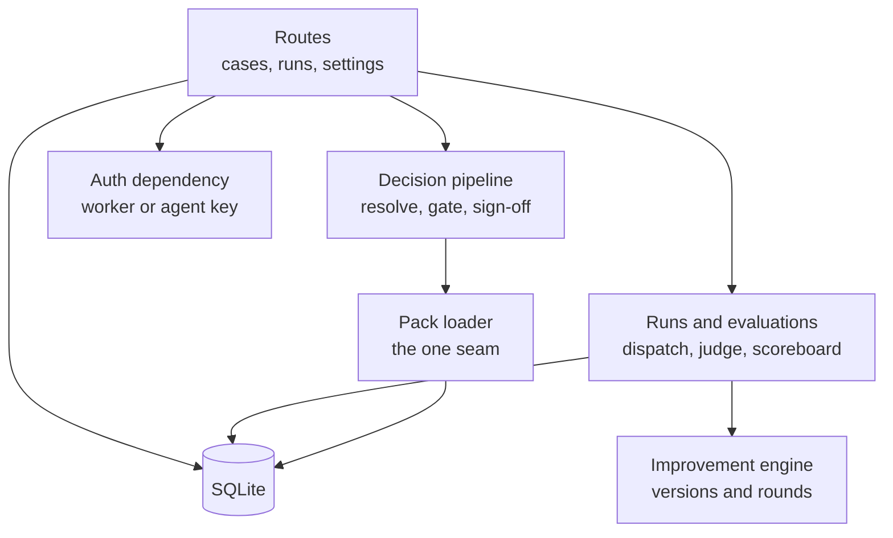

# C4 components

Inside the backend container: the parts one case passes through.

## Notes

- **The seam.** The loader is the only module that reads a pack, and the
  protocol verbs (`resolve`, `gate`, `execute`, `summarize`, `metric`) are
  the only code a pack ships.
- **The gate.** Every approval passes the pack's sign-off question; a held
  decision waits for a lead and cannot pay before one.
- **The improvement engine.** Held-out sets, judge grades, and instruction
  versions; the lead approves what ships.
