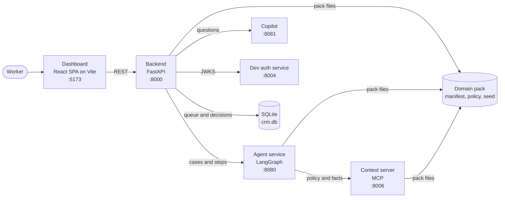

# C4 containers

The runnable units of the engine, and where each one lives.

## Notes

- **Runnable units.** Five services and one file-backed store; `npm run dev`
  starts all five, and the e2e suite starts its own set on other ports.
- **The pack is data.** `CRM_DOMAIN` names it, and three services read it
  through one loader; no pack name appears in engine code.
- **Open question.** The runtime route (`CRM_AGENT_RUNTIME`) swaps the agent
  service for an AgentCore invoke; the wiring gate proves it against floci.
