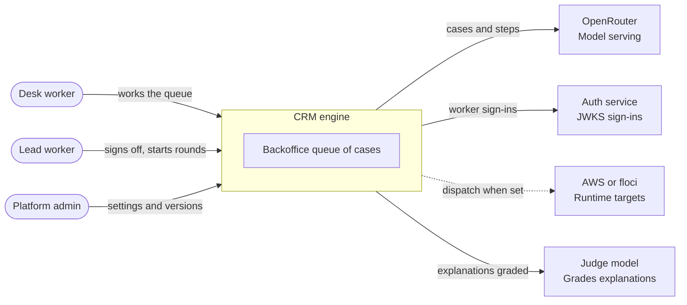

# C4 context

Who uses the crm engine, and what it talks to. The engine carries no domain
word; the active pack gives it one.

## Notes

- **Boundaries.** The people reach the engine through the dashboard only;
  the borrowers of the library pack hold no sign-in.
- **Responsibilities.** The engine owns the queue, the decisions, the
  sign-off, and the runs; the pack owns every domain word.
- **Assumptions.** The model key stays optional; the tests and the e2e run
  against a stub model and stand-ins.
- **Open question.** A read-only borrower view is a recorded follow-up, not
  a boundary today.
