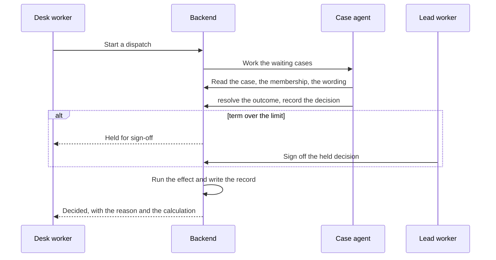

# Case flow

One case, from the queue to the executed outcome. The sequence shows the
library desk of the current assignment; every pack follows the same shape.

## Where to watch it

- The queue page shows each case's state: waiting, in progress, held,
  decided.
- The run panel follows a dispatch while it works.
- The scoreboard keeps the score of every run and evaluation.
- [Screenshots](Screenshots.md) captures each step of this flow on the
  library pack.
