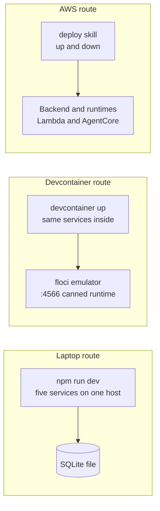

# Deployment

Three ways to run the same engine, from the closest to the farthest.

## The routes

| Route | Skill | What it proves |
| --- | --- | --- |
| Laptop | `crm-setup` | The desk runs with one command, no model key needed for the tests. |
| Devcontainer + floci | `crm-local-aws` | The same services run in a container, and the runtime invoke path reaches the emulator. |
| AWS | `crm-aws-rollout` | The real account carries the backend and the runtimes, and comes back down clean. |

## Rules

- The emulator first ([ADR 0008](../../adr/0008-local-emulator-first-aws-targets.md)):
  the AWS targets answer against floci before a real account sees them.
- `CRM_AGENT_RUNTIME` set means dispatches flow to the runtime; unset means
  the agent service on the laptop route.
- The wiring gate (`deploy/verify_wiring.py`) prints
  `wiring ok: backend caller -> botocore -> emulator -> acceptance` and
  exits 0 on the container route.
