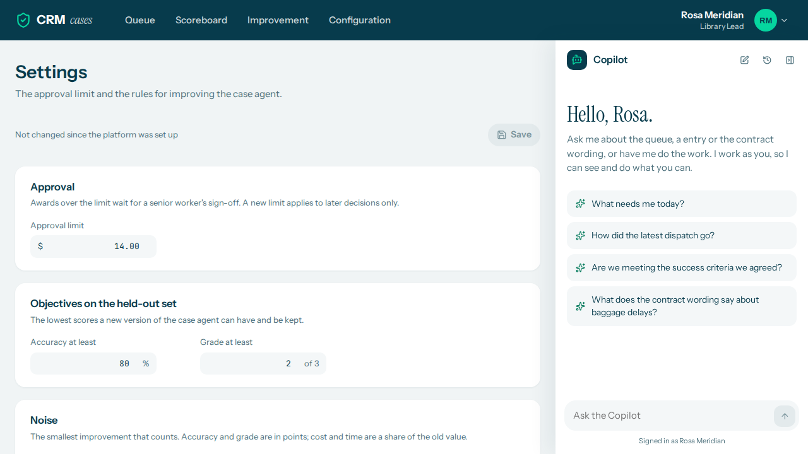

# The IT setup

## The stack

- Python 3.12, FastAPI, SQLite, and a LangGraph agent harness.
- Node 22 and a React dashboard.
- The packs under `crm/domains/`; `CRM_DOMAIN` names the active pack.

## Install and run

You need Python 3.12 or newer, Node 22 or newer, and uv.

```bash
uv sync --project crm
npm install --prefix crm
npm run seed --prefix crm
npm run dev --prefix crm
```

The dashboard lives on `http://localhost:5173`, and the backend answers on
`http://localhost:8000/api/health`.

## The checks

```bash
npm run check --prefix crm    # ruff, pyright, pytest, prettier, eslint, tsc, vitest, e2e
CRM_DOMAIN=library npx playwright test --prefix crm   # the loan desk flow
```

The Python suite is hermetic: a stub model stands in for the model service,
and every test gets its own seeded database.

## The devcontainer

The devcontainer at `crm/.devcontainer/` carries Python 3.12, Node, and the
docker feature with the moby option off, because moby carries no packages
for the trixie base image.

```bash
npx @devcontainers/cli up --workspace-folder crm --mount-workspace-git-root=false
npx @devcontainers/cli exec --workspace-folder crm -- bash -c \
  'cd /workspaces/crm && CRM_DOMAIN=library uv run python validate.py library'
```

`--mount-workspace-git-root=false` matters: the config's workspace folder is
`/workspaces/crm`, and the CLI mounts the git root without the flag.

Inside the container, the full evidence run is: the pack validator, the
smoke run, the pack tests, and the whole suite. All four are green at
99.28 percent coverage.

## The floci emulator

The AWS targets run against the local emulator first
([ADR 0008](../../adr/0008-local-emulator-first-aws-targets.md)):

```bash
docker compose -f crm/deploy/compose.yaml up -d
cd crm
AWS_ENDPOINT_URL=http://localhost:4566 AWS_DEFAULT_REGION=us-east-1 \
AWS_ACCESS_KEY_ID=test AWS_SECRET_ACCESS_KEY=test \
uv run python deploy/verify_wiring.py
```

The gate prints `wiring ok: backend caller -> botocore -> emulator ->
acceptance` and exits 0. The emulator proves the wiring; its runtime
answers are canned, so the agent's behavior stays with the hermetic tests
and the human checks.

## The settings page

The approval limit of the pack shows on the settings page: 14.00 days for
the library.


