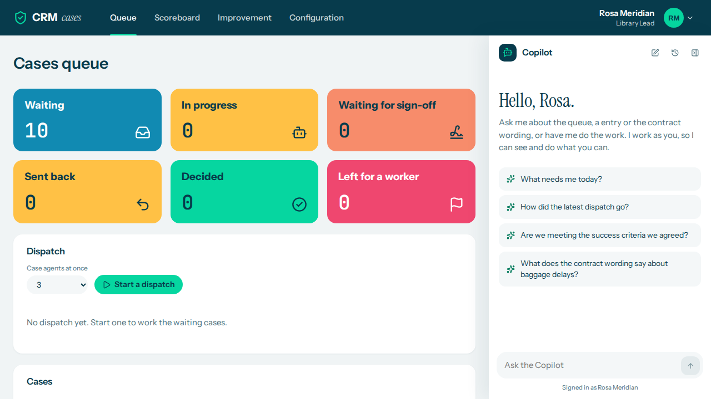
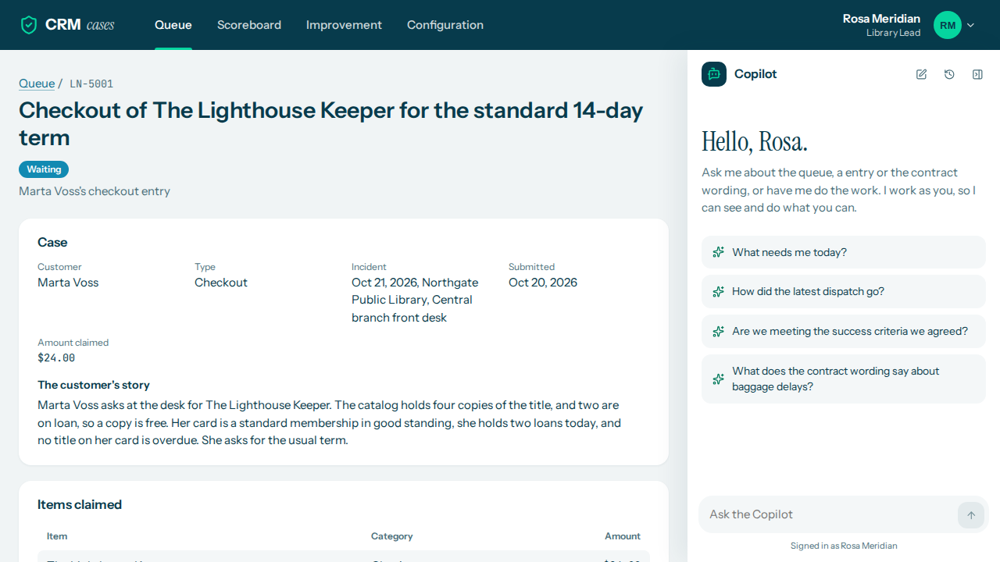

# The library domain

Northgate Public Library runs as one pack of the crm engine, at
`crm/domains/library/`. The engine carries the queue, the decisions, the
sign-off, and the scoreboard, and the pack carries every library word.

## The mapping

| Engine noun | Library noun |
| --- | --- |
| Case | Loan request |
| Customer | Borrower |
| Contract | Membership, with its tier and its loan count |
| Worker | Librarian, with the lead over the limit |
| Award | Loan term in days |
| Sign-off | The lead's approval of a term over 14 days |

## The rules

- A checkout needs one free copy of the title.
- Every loan runs 14 days from the day the desk issues it.
- A borrower holds at most three loans at the same time, on both tiers.
- A research membership renews to 28 days in total; a term over 14 days
  needs the lead librarian's sign-off.
- A special collection title, or a title at $200.00 or more, goes to the
  lead.

The wording at `crm/domains/library/policy/wording.md` is the contract with
the borrower, and the manual at `policy/manual.md` says how the desk reads
it.

## The flow of one request

1. The borrower hands a request at the desk, and the desk takes it into the
   queue with the copy counts and the membership facts.
2. The case agent reads the request, the membership, and the policy
   documents, and approves, declines, or refers.
3. On an approval, the rules work the term out step by step. A term over 14
   days waits for the lead's sign-off.
4. The system issues the loan, and the record keeps the title and the days.

## The queue and a request





## Try it

```bash
cd crm
CRM_DOMAIN=library uv run python validate.py library
CRM_DOMAIN=library uv run python smoke.py library
npm run dev        # the desk lives on http://localhost:5173
```

Sign in as `rosa.meridian@northgate.example` (lead) or
`iris.bonnell@northgate.example` (desk), with the dev password `crm-dev`.
