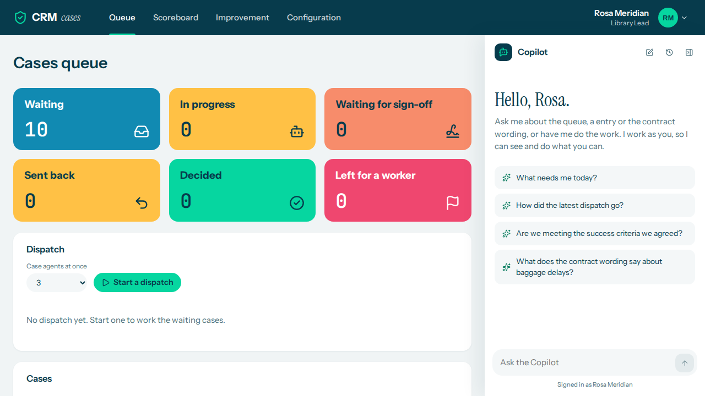
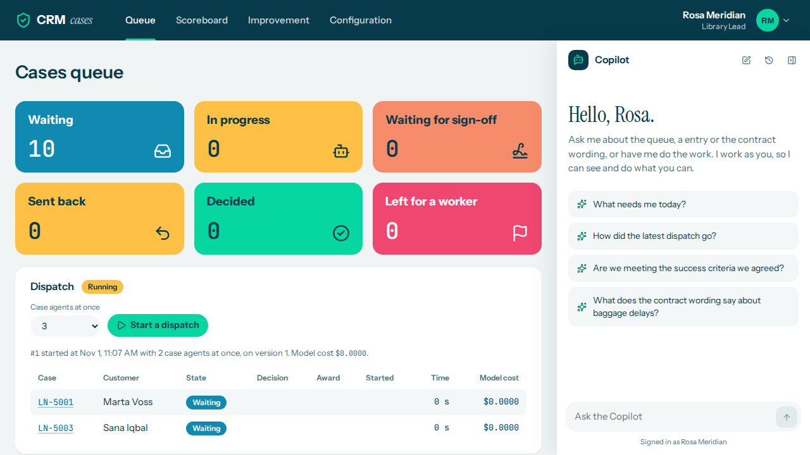
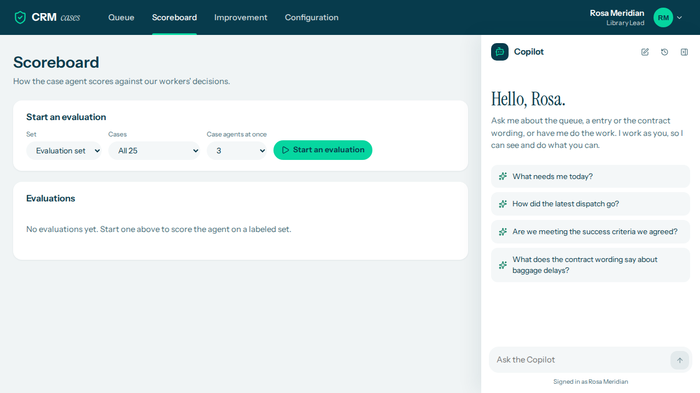
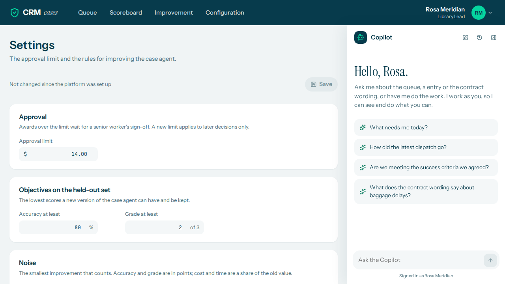

# Screenshots

The loan desk flow of the library pack, captured end to end by
`crm/e2e/wiki_flow.spec.ts` (run it with `WIKI_SHOTS_DIR` set). The
dispatch walk carries its own gate (`WIKI_FLOW_FULL=1`), because the agent
stand-in flow it drives fails on the current host on the clean tree too;
the missing steps land when that environment issue is fixed.

## The steps

The walk runs on the library pack (`CRM_DOMAIN=library`), on the devcontainer
stack that `crm/local-up.sh` brings up.

| Step | Shot |
| --- | --- |
| The queue, waiting | [02-queue.png](../../crm/docs/screenshots/02-queue.png) |
| The dispatch, running | [03-dispatch-running.png](../../crm/docs/screenshots/03-dispatch-running.png) |
| The scoreboard | [08-scoreboard.png](../../crm/docs/screenshots/08-scoreboard.png) |
| The settings, with the pack limit | [09-settings.png](../../crm/docs/screenshots/09-settings.png) |

## The queue

## The dispatch running

## The scoreboard

## The settings

