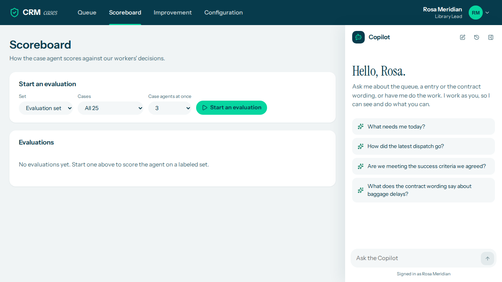

# The self-improving domain agent

The desk agent improves itself under supervision. The engine carries the
loop, and the pack carries the judgments.

## The loop

1. **The held-out set.** Loan requests the agent never saw, with the
   librarians' own decisions pinned beside them. The set stays out of the
   queue.
2. **The evaluation run.** The agent works the held-out set, and a judge
   grades every answer against the pinned decisions.
3. **The improver.** It reads the mistakes, adds one rule to the
   instructions for each kind, and proposes a new version with its reason.
   It follows the round's recipe exactly.
4. **The lead decides.** A version ships only when it beats the objectives
   on the held-out set, and the lead approves it. The loan rules and the
   approval limit never move.

## Where each part lives

| Part | File |
| --- | --- |
| The pinned decisions | `crm/domains/library/evals/decisions.json` |
| The held-out set | `crm/domains/library/evals/held_out_cases.json` |
| The improver's instructions | `crm/domains/library/instructions/improver.md` |
| The round recipe | `crm/domains/library/instructions/recipe.md` |
| The objectives and noise | `crm/domains/library/data/improvement.json` |
| The scores | the scoreboard of the dashboard |

## The video

The one-minute tour: [self-improving.mp4](../videos/self-improving.mp4),
rendered from [its deck](../videos/decks/self-improving.json).

## The scoreboard

Every run and evaluation lands on the scoreboard of the dashboard, signed
in as the lead librarian.

